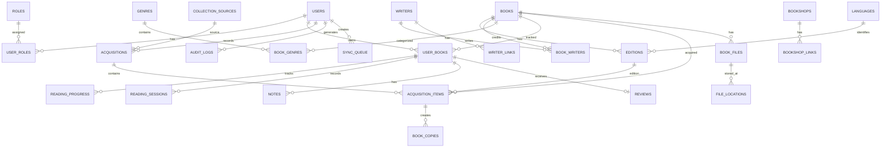

# KutubCore — Complete Project Blueprint

**Digital Book Collection Management System (DBCMS)**  
**Architecture:** Offline-first · Personal + Community · Go · SQLite → PostgreSQL  
**Document status:** Architecture baseline / implementation blueprint  
**Version:** 1.0  
**Date:** 9 November 2026

---

## 1. Executive Summary

KutubCore is an offline-first personal and community-driven digital library management system. It helps users catalog books, organize collections by language and genre, track physical and digital acquisition, manage reading progress, keep private notes and reviews, discover writers and collection sources, and optionally synchronize data across devices.

The system supports three access experiences:

- **Guest:** Search and browse public catalog records.
- **Reader:** Maintain a private personal library, collection status, reading progress, notes, reviews, and favorites.
- **Organizer:** Reader permissions plus shared catalog management.

A single account can be both Reader and Organizer. Organizer activation is self-service, as selected for this project. Catalog changes are audited and protected by validation, rate limits, soft deletion, and duplicate detection.

### Product principles

1. Offline-first: core catalog and personal-library workflows work without internet.
2. One shared catalog, separate personal libraries.
3. Book identity, edition identity, and personal ownership are distinct.
4. Physical and digital acquisition statuses are independent.
5. Reading status is independent from collection status.
6. Local-first data ownership, explicit backup, and controlled synchronization.
7. Start with a modular monolith; do not introduce microservices prematurely.

---

## 2. Confirmed Architecture Decisions

| Area | Decision |
|---|---|
| Product name | KutubCore |
| Product type | Digital Book Collection Management System |
| Deployment | Hybrid: standalone, LAN, and future cloud |
| User model | Personal library and shared catalog |
| Backend | Go |
| Frontend | HTML, CSS, Vanilla JavaScript |
| UI delivery | PWA |
| Initial database | SQLite |
| Future database | PostgreSQL |
| Cloud database preference | Neon PostgreSQL |
| File storage | Local files plus external URLs |
| Organizer activation | Self-activation by registered users |
| Guest access | Public, read-only catalog |
| API | REST + JSON |
| Search | SQLite FTS5 initially |
| IDs | UUID |
| Sync | Bidirectional, added after local MVP |

### Deployment modes

- **Standalone:** Go service and SQLite on one computer; browser/PWA accesses the local service.
- **LAN:** One host runs Go and SQLite. Other devices use the host's HTTP API. Never place a live SQLite database on a network share and let multiple clients open it directly.
- **Cloud:** Remote Go API and PostgreSQL. Local clients synchronize through the API.

Use the same application and domain model in all modes. Only configuration, database adapter, and deployment profile should differ.

---

## 3. Scope and Functional Modules

1. **Book Catalog:** title, subtitle, description, original title, cover, identifiers.
2. **Editions:** ISBN, language, publisher, edition number, year, format, page count.
3. **Writer Directory:** biography, website, contact details, social links.
4. **Language Collections:** language codes, native names, active/inactive state.
5. **Genre Classification:** hierarchical genres and many-to-many book mapping.
6. **Bookshop Directory:** physical and online shops, addresses, contact details, multiple URLs.
7. **Collection Sources:** bookshop, library, gift, friend, publisher, online repository, other.
8. **Acquisition Tracking:** when, where, how, and in what format a book was acquired.
9. **Personal Library:** per-user book status and personal collection.
10. **Reading Tracker:** want to read, currently reading, on hold, completed, abandoned.
11. **Reader Journal:** private notes, reviews, star ratings, reaction labels, favorites.
12. **Digital Files:** local PDF/EPUB files and external file URLs.
13. **Dashboard and Analytics:** collection totals, reading activity, monthly statistics.
14. **Offline and Sync:** local persistence, queue, device metadata, future remote synchronization.
15. **Bookshelf Life:** optional cosmetic gamification such as dust, cobwebs, and bookworms.

---

## 4. User Roles and Permissions

### Guest
- Search and browse public books.
- View public book, writer, edition, and source details.
- Cannot access personal data or make catalog changes.

### Reader
- All Guest permissions.
- Create and manage a personal library.
- Set physical and digital acquisition statuses.
- Track reading progress and sessions.
- Create private notes and reviews.
- Rate and favorite books.

### Organizer
- All Reader permissions.
- Add and edit shared books, editions, writers, genres, languages, bookshops, and sources.
- Manage duplicate catalog records.
- View audit history for catalog operations.

### Authorization rules

- Roles are records linked to users, not separate account types.
- Every registered user can self-activate the Organizer role.
- Organizer status does not grant access to another user's private library.
- Personal records must be checked against the authenticated user on every request.
- Shared catalog changes must create audit records.
- Use soft deletion/archive for catalog records instead of immediate destructive deletion.
- Sensitive system-wide settings can remain restricted to a future Owner/System Admin permission.

---

## 5. Core Domain Model

Keep these concepts separate:

### A. Catalog identity
What is the logical work? Example: a novel or a non-fiction title.

### B. Edition identity
Which published version? Example: Bengali paperback, English hardcover, EPUB edition.

### C. Personal identity
What is the status of this book for a particular reader? Example: owned, want to buy, currently reading.

A book may have multiple editions, writers, and genres. A reader may track the logical book in their personal library while acquisition records identify the exact edition and copies.

### Collection status

Physical status:
- `not_collected`
- `want_to_buy`
- `owned`

Digital status:
- `not_available`
- `want_to_download`
- `downloaded`

### Reading status

- `want_to_read`
- `currently_reading`
- `on_hold`
- `completed`
- `abandoned`

These are independent. A user may own a paperback and have a PDF, but not have started reading either.

### Reactions

Use a separate reaction field:
- `favorite`
- `average`
- `meh`
- `legend`

Star rating is a separate optional integer from 1 to 5. Do not mix reaction labels and star ratings.

---

## 6. Database Architecture

Use a repository abstraction and separate SQLite/PostgreSQL adapters. Prefer portable SQL, explicit migrations, UUID identifiers, UTC timestamps, parameterized queries, and foreign keys.

### Table inventory

| Domain | Tables |
|---|---|
| Identity | `users`, `roles`, `user_roles`, `user_profiles` |
| Catalog | `books`, `editions`, `book_identifiers` |
| Writers | `writers`, `book_writers`, `writer_links`, `writer_contacts` |
| Classification | `languages`, `genres`, `book_genres` |
| Sources | `collection_sources`, `bookshops`, `bookshop_links`, `source_links` |
| Acquisition | `acquisitions`, `acquisition_items`, `book_copies` |
| Personal library | `user_books`, `reading_progress`, `reading_sessions` |
| Journal | `notes`, `reviews` |
| Files | `book_files`, `file_locations` |
| System | `audit_logs`, `sync_queue`, `sync_metadata`, `app_settings` |

### Entity Relationship Diagram



### Recommended table definitions

The following is the logical schema. Exact SQL types and migration syntax should be adapted per database driver.

#### `users`
- `id` UUID primary key
- `display_name` VARCHAR(120) NOT NULL
- `email` VARCHAR(255) nullable, unique when present
- `mobile` VARCHAR(30) nullable
- `password_hash` TEXT nullable
- `is_active` BOOLEAN NOT NULL DEFAULT TRUE
- `created_at`, `updated_at` UTC timestamps

Require at least one login identifier (email or mobile) for accounts that use password authentication. Guest users do not need a row.

#### `roles`
- `id` UUID primary key
- `code` VARCHAR(30) unique (`reader`, `organizer`)
- `name` VARCHAR(60) not null

#### `user_roles`
- `user_id` UUID FK to users
- `role_id` UUID FK to roles
- `created_at`
- composite primary key or unique constraint on (`user_id`, `role_id`)

#### `books`
- `id` UUID primary key
- `title` VARCHAR(300) NOT NULL
- `subtitle` VARCHAR(300) nullable
- `description` TEXT nullable
- `original_title` VARCHAR(300) nullable
- `cover_image_id` UUID nullable
- `created_by` UUID FK to users
- `created_at`, `updated_at`
- `deleted_at` nullable

Do not store edition-specific ISBN, publisher, or publication year here.

#### `editions`
- `id` UUID primary key
- `book_id` UUID FK to books
- `language_id` UUID FK to languages
- `publisher` VARCHAR(200) nullable
- `edition_number` VARCHAR(50) nullable
- `publication_year` INTEGER nullable
- `format` VARCHAR(30) not null
- `page_count` INTEGER nullable
- `created_at`, `updated_at`

Allowed format values: `paperback`, `hardcover`, `ebook`, `pdf`, `epub`, `audiobook`, `other`.

#### `book_identifiers`
- `id` UUID primary key
- `edition_id` UUID FK to editions
- `identifier_type` VARCHAR(20) (`isbn10`, `isbn13`, other future identifiers)
- `identifier_value` VARCHAR(40) not null
- unique (`identifier_type`, `identifier_value`) where appropriate

#### `writers`
- `id` UUID primary key
- `full_name` VARCHAR(200) not null
- `biography` TEXT nullable
- `birth_date`, `death_date` nullable
- `website` TEXT nullable
- `created_at`, `updated_at`

#### `book_writers`
- `book_id` UUID FK
- `writer_id` UUID FK
- `contribution_role` VARCHAR(40) default `author`
- `display_order` INTEGER
- unique (`book_id`, `writer_id`, `contribution_role`)

#### `writer_links`
- `id` UUID primary key
- `writer_id` UUID FK
- `platform` VARCHAR(50) not null
- `url` TEXT not null

#### `writer_contacts`
- `id` UUID primary key
- `writer_id` UUID FK
- `contact_type` VARCHAR(30) (`email`, `mobile`, `address`)
- `contact_value` TEXT not null
- `is_public` BOOLEAN default FALSE

#### `languages`
- `id` UUID primary key
- `name` VARCHAR(100) not null
- `code` VARCHAR(20) unique
- `native_name` VARCHAR(100) nullable
- `is_active` BOOLEAN default TRUE

#### `genres`
- `id` UUID primary key
- `name` VARCHAR(120) not null
- `slug` VARCHAR(140) unique
- `parent_id` UUID nullable FK to genres
- `description` TEXT nullable
- `is_active` BOOLEAN default TRUE

#### `book_genres`
- `book_id` UUID FK
- `genre_id` UUID FK
- composite primary key (`book_id`, `genre_id`)

#### `collection_sources`
- `id` UUID primary key
- `name` VARCHAR(160) not null
- `source_type` VARCHAR(40) not null
- `description` TEXT nullable
- `created_at`, `updated_at`

Examples: `bookshop`, `library`, `gift`, `friend`, `publisher`, `online_repository`, `other`.

#### `bookshops`
- `id` UUID primary key
- `name` VARCHAR(200) not null
- `shop_type` VARCHAR(30) (`physical`, `online`, `both`)
- `address` TEXT nullable
- `city`, `country` nullable
- `phone`, `email`, `website` nullable
- `notes` TEXT nullable

#### `bookshop_links`
- `id` UUID primary key
- `bookshop_id` UUID FK
- `label` VARCHAR(80) not null
- `url` TEXT not null
- `is_primary` BOOLEAN default FALSE

#### `source_links`
- `id` UUID primary key
- `source_id` UUID FK
- `label` VARCHAR(80)
- `url` TEXT

#### `acquisitions`
- `id` UUID primary key
- `user_id` UUID FK
- `source_id` UUID nullable FK to collection_sources
- `bookshop_id` UUID nullable FK to bookshops
- `acquisition_date` DATE nullable
- `total_cost` DECIMAL-compatible numeric nullable
- `currency_code` VARCHAR(3) nullable
- `notes` TEXT nullable
- `created_at`

#### `acquisition_items`
- `id` UUID primary key
- `acquisition_id` UUID FK
- `book_id` UUID FK
- `edition_id` UUID nullable FK
- `quantity` INTEGER not null default 1
- `unit_price` DECIMAL-compatible numeric nullable
- `format` VARCHAR(30) not null

#### `book_copies`
- `id` UUID primary key
- `acquisition_item_id` UUID FK
- `edition_id` UUID nullable FK
- `format` VARCHAR(30) not null
- `condition` VARCHAR(30) nullable (`new`, `good`, `fair`, `damaged`)
- `storage_location` VARCHAR(200) nullable
- `acquired_at` DATE nullable
- `notes` TEXT nullable

#### `user_books`
- `id` UUID primary key
- `user_id` UUID FK
- `book_id` UUID FK
- `physical_status` VARCHAR(30) not null default `not_collected`
- `digital_status` VARCHAR(30) not null default `not_available`
- `reading_status` VARCHAR(30) not null default `want_to_read`
- `is_favorite` BOOLEAN not null default FALSE
- `created_at`, `updated_at`
- unique (`user_id`, `book_id`)

#### `reading_progress`
- `id` UUID primary key
- `user_book_id` UUID FK
- `current_page` INTEGER nullable
- `total_pages` INTEGER nullable
- `progress_percent` numeric not null default 0
- `started_at`, `completed_at` nullable
- `updated_at`

#### `reading_sessions`
- `id` UUID primary key
- `user_book_id` UUID FK
- `started_at`, `ended_at`
- `pages_read` INTEGER nullable
- `reading_note` TEXT nullable

#### `notes`
- `id` UUID primary key
- `user_book_id` UUID FK
- `title` VARCHAR(200) nullable
- `content` TEXT not null
- `page_number` INTEGER nullable
- `visibility` VARCHAR(20) not null default `private`
- `created_at`, `updated_at`

#### `reviews`
- `id` UUID primary key
- `user_book_id` UUID FK unique
- `rating` INTEGER nullable (1–5)
- `reaction` VARCHAR(20) nullable (`favorite`, `average`, `meh`, `legend`)
- `review_text` TEXT nullable
- `created_at`, `updated_at`

Use `user_books.is_favorite` for favorite state; do not duplicate it in a separate favorites table.

#### `book_files`
- `id` UUID primary key
- `book_id` UUID FK
- `edition_id` UUID nullable FK
- `file_name` VARCHAR(255) not null
- `file_format` VARCHAR(20) not null
- `file_size` BIGINT nullable
- `checksum_sha256` VARCHAR(64) nullable
- `mime_type` VARCHAR(120) nullable
- `created_at`

#### `file_locations`
- `id` UUID primary key
- `book_file_id` UUID FK
- `location_type` VARCHAR(20) (`local`, `external_url`, `network`)
- `storage_path` TEXT nullable
- `external_url` TEXT nullable
- `is_available` BOOLEAN default TRUE

#### `audit_logs`
- `id` UUID primary key
- `actor_user_id` UUID nullable FK
- `entity_type` VARCHAR(60) not null
- `entity_id` UUID not null
- `action` VARCHAR(30) not null
- `before_json`, `after_json` nullable
- `created_at`

#### `sync_queue`
- `id` UUID primary key
- `entity_type` VARCHAR(60) not null
- `entity_id` UUID not null
- `operation` VARCHAR(20) not null
- `payload_json` TEXT not null
- `status` VARCHAR(20) not null default `pending`
- `created_at`, `synced_at` nullable
- `retry_count` INTEGER not null default 0

#### `sync_metadata`
- `device_id` UUID primary key
- `last_sync_cursor` TEXT nullable
- `last_sync_at` nullable
- `updated_at`

#### `app_settings`
- `key` VARCHAR(120) primary key
- `value_json` TEXT not null
- `updated_at`

---

## 7. Database Constraints and Business Rules

### Important uniqueness rules

- `users.email`: unique when non-null; normalize case before comparison.
- `user_roles`: unique (`user_id`, `role_id`).
- `book_writers`: unique (`book_id`, `writer_id`, `contribution_role`).
- `book_genres`: unique (`book_id`, `genre_id`).
- `user_books`: unique (`user_id`, `book_id`).
- `bookshop_links`: unique (`bookshop_id`, `url`).
- `writer_links`: unique (`writer_id`, `url`).
- `reviews`: unique (`user_book_id`).

### Check constraints

```sql
CHECK (page_count IS NULL OR page_count > 0);

CHECK (
  progress_percent >= 0
  AND progress_percent <= 100
);

CHECK (current_page IS NULL OR current_page >= 0);

CHECK (
  total_pages IS NULL
  OR current_page IS NULL
  OR current_page <= total_pages
);

CHECK (rating IS NULL OR rating BETWEEN 1 AND 5);

CHECK (
  started_at IS NULL
  OR ended_at IS NULL
  OR ended_at >= started_at
);
```

Use `VARCHAR + CHECK` for portable status values instead of relying on PostgreSQL-only enum types.

### Foreign key and deletion policies

- Catalog records should generally use soft deletion (`deleted_at`).
- Do not cascade-delete acquisition history when a bookshop is archived.
- Do not delete a writer while book relationships exist without an explicit reassignment/archive flow.
- Personal data deletion must follow a documented retention/export policy.
- Audit logs should not be deleted by ordinary catalog operations.
- Enable SQLite foreign keys on every database connection.

```sql
PRAGMA foreign_keys = ON;
```

### Additional rules

1. `owned` requires at least one physical copy record.
2. `downloaded` requires an available local or explicitly accessible digital file.
3. `completed` should set `completed_at`.
4. Current page cannot exceed total pages.
5. Notes are private by default.
6. Reading progress must never modify acquisition status.
7. Acquisition history must remain independent from current collection status.
8. A book may have several editions and multiple copies.
9. A genre cannot be its own parent; prevent hierarchy cycles in service logic.
10. A URL being saved does not mean the linked file is downloaded or available.

---

## 8. File Storage Design

Store PDF/EPUB and cover files on the filesystem or configured object storage. Keep metadata and locations in the database; do not store large files as database BLOBs by default.

Suggested data directory:

```text
KutubCore/
├── data/
│   ├── kutubcore.db
│   ├── files/
│   │   ├── covers/
│   │   ├── books/
│   │   └── thumbnails/
│   ├── backups/
│   └── logs/
```

Requirements:
- Generate safe internal filenames; do not trust uploaded filenames as paths.
- Validate file size, extension, and MIME type.
- Calculate SHA-256 checksums for duplicate detection and integrity checks.
- Prevent path traversal.
- Serve private files only after authorization.
- Support local path, network path, and external URL locations.
- Clearly distinguish `downloaded`, `external link`, and `unavailable`.
- Include file metadata and actual files in backup/restore workflows.

---

## 9. REST API Architecture

Base path: `/api/v1`

### Authentication
| Endpoint | Method | Access |
|---|---|---|
| `/auth/register` | POST | Public |
| `/auth/login` | POST | Public |
| `/auth/logout` | POST | Authenticated |
| `/auth/me` | GET | Authenticated |

### User and roles
| Endpoint | Method | Access |
|---|---|---|
| `/users/me` | GET/PATCH | Owner |
| `/users/me/roles` | GET | Owner |
| `/users/me/roles/organizer` | POST | Authenticated |

### Catalog
| Endpoint | Method | Access |
|---|---|---|
| `/books` | GET | Public |
| `/books` | POST | Organizer |
| `/books/{id}` | GET | Public |
| `/books/{id}` | PATCH/DELETE | Organizer |
| `/books/{id}/editions` | GET/POST | Public GET / Organizer POST |
| `/writers` | GET/POST | Public GET / Organizer POST |
| `/genres` | GET/POST | Public GET / Organizer POST |
| `/languages` | GET/POST | Public GET / Organizer POST |
| `/bookshops` | GET/POST | Public GET / Organizer POST |
| `/sources` | GET/POST | Public GET / Organizer POST |

### Personal library
| Endpoint | Method | Access |
|---|---|---|
| `/me/books` | GET/POST | Authenticated |
| `/me/books/{id}` | GET/PATCH/DELETE | Owner |
| `/me/books/{id}/progress` | GET/PUT | Owner |
| `/me/books/{id}/sessions` | GET/POST | Owner |
| `/me/books/{id}/notes` | GET/POST | Owner |
| `/me/books/{id}/notes/{noteId}` | PATCH/DELETE | Owner |
| `/me/books/{id}/review` | GET/PUT/DELETE | Owner |
| `/me/dashboard` | GET | Authenticated |

### Files and search
| Endpoint | Method | Access |
|---|---|---|
| `/books/{id}/files` | GET | Public metadata only |
| `/books/{id}/files` | POST | Organizer |
| `/files/{id}/download` | GET | Authorized |
| `/search` | GET | Public |

### Synchronization (future phase)
| Endpoint | Method | Access |
|---|---|---|
| `/sync/push` | POST | Authenticated device |
| `/sync/pull` | GET | Authenticated device |
| `/sync/status` | GET | Authenticated device |

### API conventions

- JSON request/response.
- Pagination: `limit`, `cursor` or `page`, `sort`.
- Filters should be explicit and validated.
- Use request IDs for tracing.
- Use idempotency keys for retryable create/sync operations where appropriate.
- Use optimistic concurrency (`version` or `If-Match`) for shared catalog edits.
- Never accept a user ID from the client as proof of ownership; derive identity from the authenticated session.

Example success:

```json
{
  "success": true,
  "data": {
    "id": "book-uuid",
    "title": "Example Book"
  },
  "meta": null
}
```

Example error:

```json
{
  "success": false,
  "error": {
    "code": "BOOK_NOT_FOUND",
    "message": "Book was not found."
  }
}
```

HTTP status codes: 200, 201, 204, 400, 401, 403, 404, 409, 422, 500.

---

## 10. Offline-First and Synchronization Design

### Local operation

1. User changes data.
2. Go service validates and writes to SQLite.
3. A sync event is recorded in the same database transaction when the entity is sync-enabled.
4. If offline, the event remains pending.
5. When online, the client/device pushes pending events.
6. Server validates authorization and version.
7. Server accepts or reports a conflict.
8. Client pulls remote changes and updates local records.

### Sync metadata

Every syncable entity should have:
- UUID primary key
- `created_at`
- `updated_at`
- `deleted_at` for tombstones where needed
- `version` or revision number

Device metadata should include a stable `device_id` and last successful sync cursor.

### Conflict strategies

| Data | Strategy |
|---|---|
| Book metadata | Optimistic version check; explicit conflict resolution |
| Reading progress | Preserve session history; reconcile latest valid state |
| Notes | Revision history; do not silently overwrite |
| Favorites | Last-write-wins can be acceptable |
| Reviews | Revision history |
| Acquisition records | Append/preserve events; avoid destructive merge |

Do not implement full cloud sync in the first MVP. Prepare UUIDs, timestamps, version fields, sync metadata, and queue structures first.

### PWA and service worker

- Cache the app shell and static assets.
- Use network-first or stale-while-revalidate strategies for public catalog reads as appropriate.
- Keep sensitive personal data out of shared caches.
- Use the local Go API for durable local persistence.
- Explain that a browser cannot reach the local API if the Go service is stopped.
- Add an explicit service/connection status indicator.

---

## 11. UI and UX Specification

### Design direction

- Traditional library atmosphere with a clean modern interface.
- Reading-focused, low-distraction layout.
- Responsive desktop, tablet, and mobile design.
- Light and dark themes.
- SVG icon library.
- Keyboard accessibility and visible focus states.
- Clear offline, pending-sync, and error indicators.

### Main navigation

1. Dashboard
2. Book Catalog
3. My Collection
4. Reading Tracker
5. Writers
6. Bookshops
7. Genres & Languages
8. Organizer Workspace
9. Settings

Show Organizer Workspace only when the user has the Organizer role.

### Dashboard

Personal metrics:
- Total books in personal library
- Physical collection count
- Digital collection count
- Currently reading
- Completed
- Want to read
- Recent reading sessions
- Recently added books

Catalog metrics should be visually separated from personal metrics.

### Catalog screen

- Grid and list views
- Cover, title, writers, language, genres, edition
- Search and sorting
- Filters: language, genre, writer, year, format, availability
- Duplicate warning on create/edit

### Book details screen

- Cover and title
- Writer and contributor information
- Editions and identifiers
- Language and genres
- Publisher and publication year
- Public collection-source information
- External shop URLs
- Personal collection controls for authenticated users
- Reading progress and personal review only for the owner

### Reader workspace

- Current reading list
- Progress and page counter
- Reading session history
- Private notes
- Review and reaction
- Favorite toggle
- Reading history and goals

### Organizer workspace

- Book CRUD
- Edition management
- Writer and contact management
- Genre/language management
- Bookshop and source management
- Duplicate review
- Audit history
- Archive/restore controls

### Accessibility and usability

- Forms should show validation beside the relevant field.
- Destructive actions require confirmation.
- Support keyboard navigation.
- Use semantic HTML and accessible labels.
- Do not rely on color alone to communicate status.
- Keep mobile navigation compact.

---

## 12. Bookshelf Life — Gamification

This is an optional, cosmetic feature. It must never change actual book or reading data.

Example visual stages:
- 0–29 inactive days: normal shelf
- 30–59 days: light dust
- 60–89 days: small cobweb
- 90–179 days: bookworm
- 180+ days: stronger decorative effect

Allow users to disable it or change thresholds.

Base inactivity on the user's last reading activity for that book, not merely on when the book record was created. Completed books can have a separate achievement state.

---

## 13. Go Project Structure

```text
kutubcore/
├── cmd/
│   └── kutubcore/
│       └── main.go
├── internal/
│   ├── app/
│   ├── config/
│   ├── database/
│   │   ├── sqlite/
│   │   └── postgres/
│   ├── domain/
│   │   ├── user/
│   │   ├── book/
│   │   ├── writer/
│   │   ├── genre/
│   │   ├── language/
│   │   ├── bookshop/
│   │   ├── collection/
│   │   ├── reading/
│   │   ├── review/
│   │   └── sync/
│   ├── repository/
│   ├── service/
│   ├── handler/
│   ├── middleware/
│   ├── validator/
│   └── storage/
├── web/
│   ├── static/
│   │   ├── css/
│   │   ├── js/
│   │   ├── icons/
│   │   └── images/
│   ├── templates/
│   └── manifest.webmanifest
├── migrations/
│   ├── sqlite/
│   └── postgres/
├── data/
│   ├── files/
│   ├── backups/
│   └── logs/
├── docs/
├── scripts/
├── tests/
├── .env.example
├── .gitignore
├── go.mod
└── README.md
```

### Go architectural rules

- Use a modular monolith.
- Domain packages must not depend on HTTP handlers.
- Service layer contains business rules.
- Repository interfaces isolate persistence.
- Keep SQLite and PostgreSQL-specific code in adapters.
- Use migrations rather than ad-hoc schema creation.
- Use structured logging and graceful shutdown.
- Use context-aware database calls.
- Keep configuration outside source code.
- Do not commit database files, uploaded books, secrets, or local backups.

---

## 14. Security and Privacy

| Area | Requirement |
|---|---|
| Passwords | Argon2id password hashing |
| Sessions | Secure, HttpOnly, SameSite cookies |
| Authorization | Role + record ownership |
| SQL | Parameterized queries |
| Uploads | Size, MIME, extension validation |
| File paths | Prevent path traversal |
| API | Rate limits and request validation |
| Catalog | Audit logs and soft deletion |
| LAN | Host-only database access |
| Remote | HTTPS |
| Backups | Encrypted option and restore testing |

Additional rules:
- Do not expose private notes or reading history through public catalog endpoints.
- Avoid storing unnecessary personal details.
- Writer contact details should have explicit public/private visibility.
- Organizer self-activation does not grant system-owner privileges.
- Keep secrets out of the database where practical and never commit them to Git.

---

## 15. Backup, Import, and Export

### Backup
- Manual backup
- Scheduled backup
- SQLite-consistent snapshot
- File directory backup
- Backup manifest with version and timestamp
- Integrity verification

### Export
- JSON for full structured export
- CSV for selected catalog and collection data
- Original PDF/EPUB files as separate file exports

### Restore
- Validate backup manifest
- Validate database integrity
- Check file checksums
- Restore to a staging location first
- Confirm before replacing live data

A database backup without its referenced files is incomplete if the user expects digital books and covers to be restored.

---

## 16. Testing Strategy

### Unit tests
- Status transition rules
- Genre hierarchy validation
- Permission checks
- Progress calculations
- Duplicate detection
- Sync conflict logic

### Integration tests
- SQLite migrations
- Repository CRUD
- Foreign key enforcement
- Transactions
- API authorization
- File upload/download

### End-to-end tests
- Guest search
- Organizer creates book and edition
- Reader adds book to personal library
- Reader tracks progress and notes
- Offline workflow
- Backup and restore

### Compatibility tests
- SQLite in MVP
- PostgreSQL adapter before cloud release
- Current Chrome/Firefox
- Desktop and mobile layouts

---

## 17. Development Roadmap

### Milestone 1 — Foundation
- Go initialization
- Configuration and logging
- SQLite connection
- Migrations
- Repository and service structure
- REST API foundation
- PWA shell

### Milestone 2 — Catalog
- Books and editions
- Writers and contacts
- Languages and genres
- Bookshops and sources
- Search and duplicate detection

### Milestone 3 — Reader
- Registration and login
- Personal library
- Physical/digital status
- Reading tracker
- Sessions, notes, reviews, favorites
- Dashboard

### Milestone 4 — Offline
- PWA installation
- Service worker
- Local file handling
- Search offline
- Backup/restore
- Offline test suite

### Milestone 5 — LAN and Cloud
- LAN deployment
- PostgreSQL adapter
- Remote authentication
- Sync queue and cursors
- Conflict resolution
- Cloud deployment

### Milestone 6 — Enhancements
- Reading analytics
- Reading goals
- Bookshelf Life
- Gamification
- Advanced import/export
- Recommendations

---

## 18. MVP Acceptance Criteria

The first release is ready when:

- [ ] Organizer can create and manage books and editions.
- [ ] Writers, languages, genres, bookshops, and sources can be managed.
- [ ] Guest can search and view public catalog details.
- [ ] Reader can create a personal library.
- [ ] Physical and digital collection statuses work independently.
- [ ] Reading status and progress work independently from acquisition.
- [ ] Reader can create private notes and reviews.
- [ ] Favorites work.
- [ ] Core workflows work without internet on the local host.
- [ ] Backup and restore are tested.
- [ ] Private user data is isolated.
- [ ] SQLite migrations are reproducible.
- [ ] No critical data is lost during normal shutdown/restart.

---

## 19. Documentation Pack

Maintain these files in the repository:

| File | Purpose |
|---|---|
| `README.md` | Overview and setup |
| `PROJECT_BLUEPRINT.md` | This complete blueprint |
| `ARCHITECTURE.md` | System architecture |
| `ERD.md` | Entity relationships |
| `DATABASE_SCHEMA.md` | Tables and constraints |
| `API_SPECIFICATION.md` | REST API contract |
| `UI_SPECIFICATION.md` | Screens and UX |
| `SECURITY.md` | Security requirements |
| `SYNC_DESIGN.md` | Offline sync |
| `DEVELOPMENT_ROADMAP.md` | Milestones |
| `CONTRIBUTING.md` | Contribution rules |
| `CHANGELOG.md` | Version history |

---

## 20. Final Technical Recommendations

| Concern | Recommendation |
|---|---|
| Backend | Go modular monolith |
| Database | SQLite first |
| Future DB | PostgreSQL |
| SQL access | `database/sql` + repository interfaces |
| Frontend | Vanilla JS + PWA |
| Search | SQLite FTS5 initially |
| IDs | UUID |
| API | REST + JSON |
| Authentication | Secure sessions |
| Files | Filesystem + external URLs |
| Sync | Queue + versioning + cursors |
| Deployment | Standalone → LAN → Cloud |

### Neon and Firebase

Neon is PostgreSQL-compatible and is the natural future database target. Firebase Firestore is a NoSQL database and should not be treated as a drop-in replacement for SQLite/PostgreSQL. Firebase may be considered later for separate services, but it is not required for this architecture.

### Final implementation order

Build a dependable local application first. Complete catalog, personal collection, reading tracker, file handling, and backup/restore. Then add LAN access. Only after those workflows are stable should bidirectional cloud synchronization be implemented.

**The defining design rule of KutubCore: Catalog identity, Edition identity, and Personal Library identity must remain separate.**

This separation is the foundation for a maintainable personal library today and a community library platform in the future.
